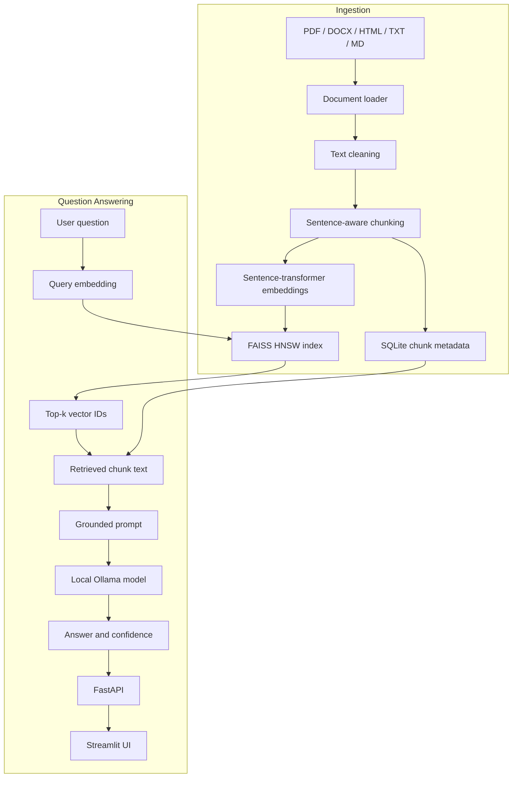

# Offline Manual AI Assistant

A local Retrieval-Augmented Generation system for asking grounded questions about technical manuals.


## Overview

The application indexes local manuals, retrieves the most relevant text for a question, and asks a locally hosted Ollama model to answer only from that context. It combines a FastAPI backend, Streamlit interface, sentence-transformer embeddings, FAISS similarity search, and SQLite metadata storage.

After the embedding and Ollama models have been downloaded, the core question-answering workflow can run without sending manual content to a hosted LLM provider.

## Features

- Local ingestion of PDF, DOCX, HTML, TXT, and Markdown manuals
- Text cleaning and sentence-aware overlapping chunks
- Cached sentence-transformer embeddings
- FAISS HNSW approximate nearest-neighbor search
- SQLite storage for chunk text and metadata
- Strict context-only prompting
- Consistent `Not found in manual` fallback
- Simple low/medium/high confidence label
- FastAPI health and question endpoints
- Streamlit browser interface
- Configurable paths, chunking, retrieval depth, model, and timeouts
- One-time model-download helper for offline preparation

## Architecture



## Project Structure

```text
.
├── app/
│   ├── config.py             # Environment configuration and paths
│   ├── document_loader.py    # PDF, DOCX, HTML, TXT, and MD loading
│   ├── text_processing.py    # Text cleanup and sentence splitting
│   ├── chunking.py           # Overlapping sentence-aware chunks
│   ├── embeddings.py         # Sentence-transformer embeddings
│   ├── vector_store.py       # FAISS index and SQLite metadata
│   ├── retriever.py          # Top-k retrieval
│   ├── llm.py                # Grounded prompt and Ollama request
│   ├── rag_pipeline.py       # Complete question-answering flow
│   ├── ingest.py             # Ingestion CLI
│   ├── schemas.py            # Data and API schemas
│   └── main.py               # FastAPI application
├── ui/app.py                 # Streamlit interface
├── scripts/download_models.py
├── data/manuals/             # Input documents
├── requirements.txt
└── README.md
```

Generated `models/` and `vector_store/` directories are excluded from Git.

## Setup

### 1. Install prerequisites

- Python 3.10 or newer
- [Ollama](https://ollama.com/)

### 2. Clone and create an environment

```bash
git clone https://github.com/SharathKumarReddyAlijarla/rag-ai-assistant.git
cd rag-ai-assistant
python -m venv .venv
```

Windows PowerShell:

```powershell
.\.venv\Scripts\Activate.ps1
```

macOS or Linux:

```bash
source .venv/bin/activate
```

Install dependencies:

```bash
python -m pip install --upgrade pip
python -m pip install -r requirements.txt
```

### 3. Download models while online

```bash
python scripts/download_models.py --ollama-model llama3
```

Other Ollama models can be selected, for example:

```bash
python scripts/download_models.py --ollama-model phi3
```

To cache only the embedding model:

```bash
python scripts/download_models.py --skip-ollama
```

### 4. Optional configuration

Create `.env` in the repository root:

```dotenv
MANUALS_PATH=data/manuals
VECTOR_DB_PATH=vector_store
MODELS_PATH=models
EMBEDDING_MODEL_NAME=all-MiniLM-L6-v2
OLLAMA_BASE_URL=http://localhost:11434
OLLAMA_MODEL=llama3
CHUNK_SIZE=500
CHUNK_OVERLAP=75
EMBEDDING_BATCH_SIZE=256
TOP_K=4
REQUEST_TIMEOUT_SECONDS=120
```

## Usage

### 1. Add and ingest manuals

Place documents under `data/manuals/`, then run:

```bash
python app/ingest.py
```

Optional ingestion overrides:

```bash
python app/ingest.py --manuals-path data/manuals --chunk-size 500 --chunk-overlap 75 --batch-size 256
```

The command creates:

```text
vector_store/index.faiss
vector_store/chunks.sqlite3
```

### 2. Start the backend

```bash
uvicorn app.main:app --reload
```

Check system state:

```text
GET http://localhost:8000/health
```

Ask a question:

```text
GET http://localhost:8000/ask?q=How%20do%20I%20start%20the%20machine%3F&top_k=4
```

Response:

```json
{
  "answer": "A grounded answer from the indexed manuals.",
  "confidence": "high"
}
```

### 3. Start the UI

In a second terminal:

```bash
streamlit run ui/app.py
```

Open the local URL displayed by Streamlit and enter a manual-related question.

## Results

The system produces short answers constrained to retrieved manual context. When the answer is absent or the model follows the explicit fallback, it returns:

```text
Not found in manual
```

Confidence is currently a transparent heuristic derived from the highest vector-similarity score:

| Best similarity | Confidence |
| ---: | --- |
| `>= 0.55` | High |
| `>= 0.35` | Medium |
| `< 0.35` | Low |

The repository does not yet include a formal retrieval or answer-quality benchmark. Production evaluation should use a labeled question-answer set covering retrieval recall, groundedness, refusal correctness, latency, and domain-specific accuracy.

## Technology Stack

| Area | Technology |
| --- | --- |
| API | FastAPI, Uvicorn |
| User interface | Streamlit |
| Local generation | Ollama |
| Embeddings | sentence-transformers |
| Vector search | FAISS HNSW |
| Metadata store | SQLite |
| Document parsing | pypdf, python-docx, BeautifulSoup, lxml |
| Numerical runtime | PyTorch, NumPy |

## Limitations

- Scanned or image-only PDFs require OCR before useful text can be indexed.
- The confidence label is heuristic and is not a calibrated probability of correctness.
- The final UI does not currently display retrieved passages or source citations.
- The API has permissive CORS settings and no authentication; it is intended for local use.
- Updating a manual requires rerunning ingestion, which rebuilds the current index.
- Initial model downloads require internet access and sufficient local disk space.
- Answer quality depends on document extraction, chunking, retrieval, and the selected Ollama model.
- CPU-only inference can be slow for larger local language models.
- Automated tests and a formal evaluation dataset are not yet included.

## Privacy Notes

After model preparation, manuals, embeddings, vector metadata, prompts, and generated answers remain on the local machine under the default configuration. Review the Ollama and operating-system configuration before using sensitive documents in a shared environment.
